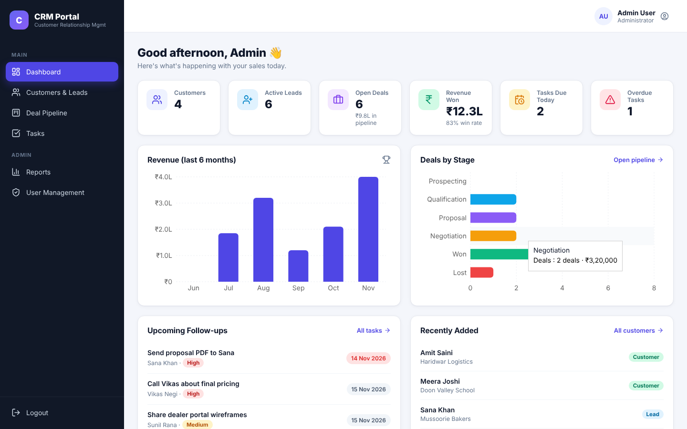

# CRM Portal using the MERN Stack

**Design and Development of a CRM (Customer Relationship Management) Portal**
Industrial Internship Project — Dtechex Technologies (Doon Technology Expert), Dehradun
Developed by **Ahana Singh**, B.Tech CSE, Graphic Era (Deemed to be University)

A full-stack web application that helps a business manage **customers & leads**, move **deals through a sales pipeline**, and track **follow-up tasks**. Staff log in securely with **JWT authentication**, and the **Admin** and **Sales Executive** roles see different data and pages (role-based access control).



---

## ✨ Features

| Module | What it does |
|---|---|
| **Authentication** | JWT login, password hashing (bcrypt), auto-logout on expired token, profile & password change |
| **Role-based access** | **Admin** sees all data, manages users, views reports, can delete customers. **Sales Executive** sees only records assigned to them |
| **Dashboard** | KPI cards (customers, leads, open deals, revenue, win rate, due/overdue tasks), 6-month revenue chart, deals-by-stage chart, upcoming follow-ups, recent customers |
| **Customer / Lead Management** | Full CRUD, search, filter by type/status/source, convert lead → customer, customer profile with related deals, tasks and notes timeline |
| **Deal Pipeline** | Kanban board with 6 stages (Prospecting → Qualification → Proposal → Negotiation → Won/Lost), **drag-and-drop** to change stage, auto win-probability, winning a deal auto-converts the lead |
| **Task Management** | Calls, emails, meetings & follow-ups with priority and due date; Today / Overdue / Upcoming / Completed views; one-click complete |
| **Reports (Admin)** | Revenue per sales executive, lead source pie chart, team performance table, **export to CSV** |
| **User Management (Admin)** | Add/edit/deactivate/delete staff accounts and assign roles |
| **Validation** | Client-side form validation + server-side Mongoose validation with clean error messages |
| **Responsive UI** | Works on desktop, tablet and mobile (collapsible sidebar) |

## 🛠 Tech Stack

- **Frontend:** React.js 18 (Vite), React Router, Axios, Recharts, Lucide icons, HTML5, CSS3
- **Backend:** Node.js, Express.js (REST API)
- **Database:** MongoDB with Mongoose ODM
- **Auth:** JSON Web Token (JWT) + bcryptjs
- **Testing:** Postman (collection included in `docs/`)
- **Version control:** Git & GitHub

## 🏗 Architecture (Three-tier)

```
┌──────────────────────┐   HTTP + JSON (Axios)   ┌────────────────────────┐   Mongoose   ┌──────────────┐
│  React.js Frontend   │ ─────────────────────▶ │  Node.js + Express API  │ ──────────▶ │   MongoDB    │
│  (Presentation tier) │ ◀───────────────────── │  (Application tier)     │ ◀────────── │  (Data tier) │
└──────────────────────┘   JWT in Auth header    └────────────────────────┘              └──────────────┘
```

## 📁 Folder Structure

```
crm-portal/
├── server/                     # Backend (Node + Express)
│   ├── config/db.js            # MongoDB connection
│   ├── models/                 # Mongoose schemas: User, Customer, Deal, Task
│   ├── controllers/            # Business logic for each module
│   ├── routes/                 # REST API routes
│   ├── middleware/             # JWT auth, role check, error handler
│   ├── utils/                  # helpers (ownership filter, async handler)
│   ├── seed/seed.js            # Demo data generator
│   └── server.js               # App entry point
├── client/                     # Frontend (React + Vite)
│   └── src/
│       ├── api/axios.js        # Axios instance with JWT interceptor
│       ├── context/            # AuthContext, ToastContext
│       ├── components/         # Layout, Modal, forms, UI helpers
│       ├── pages/              # Login, Dashboard, Customers, CustomerDetail,
│       │                       # Pipeline, Tasks, Reports, Users, Profile
│       └── index.css           # All styles
└── docs/                       # Screenshots + Postman collection
```

---

## 🚀 How to Run (Step by Step)

### 1. Prerequisites
- **Node.js 18+** → https://nodejs.org
- **MongoDB** — choose ONE:
  - **Option A (local):** Install MongoDB Community Server → https://www.mongodb.com/try/download/community (keep "Install as a Service" ticked). It runs at `mongodb://127.0.0.1:27017`.
  - **Option B (cloud, no install):** Create a free cluster on **MongoDB Atlas** → https://www.mongodb.com/atlas, click *Connect → Drivers*, copy the connection string.

### 2. Install dependencies
Open a terminal inside the `crm-portal` folder:
```bash
npm run install-all
```

### 3. Configure environment
`server/.env` is already included with local defaults:
```env
PORT=5000
MONGO_URI=mongodb://127.0.0.1:27017/crm_portal
JWT_SECRET=change_this_to_a_long_random_secret
JWT_EXPIRES_IN=7d
CLIENT_URL=http://localhost:5173
```
If you use **Atlas**, replace `MONGO_URI` with your Atlas string, e.g.
`mongodb+srv://<user>:<password>@cluster0.xxxxx.mongodb.net/crm_portal`

### 4. Load demo data
```bash
npm run seed
```

### 5. Start the app (backend + frontend together)
```bash
npm run dev
```
- Frontend → **http://localhost:5173**
- Backend API → **http://localhost:5000/api/health**

### 🔑 Demo Login
| Role | Email | Password |
|---|---|---|
| Admin | `admin@crm.com` | `admin123` |
| Sales Executive | `rahul@crm.com` | `sales123` |
| Sales Executive | `priya@crm.com` | `sales123` |

(The login page also has one-click demo buttons.)

> **Tip:** Run `npm run seed` again anytime to reset the data before your presentation.

---

## 🗄 Database Design (MongoDB Collections)

**users** — `name, email (unique), password (hashed), role [admin|sales], phone, isActive, timestamps`

**customers** — `name, email, phone, company, address, type [lead|customer], status [new|contacted|qualified|lost|active|inactive], source [website|referral|social|email|call|event|other], assignedTo → User, createdBy → User, notes[{text, author → User, createdAt}], timestamps`

**deals** — `title, customer → Customer, value, stage [prospecting|qualification|proposal|negotiation|won|lost], probability (auto), expectedCloseDate, closedAt (auto), description, assignedTo → User, createdBy → User, timestamps`

**tasks** — `title, description, type [call|email|meeting|follow-up|other], priority [low|medium|high], status [pending|in-progress|completed], dueDate, customer → Customer, deal → Deal, assignedTo → User, completedAt (auto), timestamps`

Relationships: one **User** → many Customers/Deals/Tasks; one **Customer** → many Deals & Tasks.

## 🔌 REST API Endpoints

All routes except login need header `Authorization: Bearer <token>`.

| Method | Endpoint | Description | Access |
|---|---|---|---|
| POST | `/api/auth/login` | Login, returns JWT | Public |
| GET | `/api/auth/me` | Current user | All |
| PUT | `/api/auth/profile` | Update profile / password | All |
| GET | `/api/customers` | List (search, type, status, source, pagination) | All* |
| POST | `/api/customers` | Create customer/lead | All |
| GET | `/api/customers/:id` | Details + deals + tasks | All* |
| PUT | `/api/customers/:id` | Update | All* |
| PATCH | `/api/customers/:id/convert` | Convert lead → customer | All* |
| POST | `/api/customers/:id/notes` | Add note | All* |
| DELETE | `/api/customers/:id` | Delete (+ related deals/tasks) | Admin |
| GET | `/api/deals` | List deals | All* |
| GET | `/api/deals/pipeline` | Deals grouped by stage | All* |
| POST | `/api/deals` | Create deal | All |
| PUT | `/api/deals/:id` | Update deal | All* |
| PATCH | `/api/deals/:id/stage` | Move to stage (drag & drop) | All* |
| DELETE | `/api/deals/:id` | Delete deal | All* |
| GET | `/api/tasks` | List (status, priority, due=today/overdue/upcoming) | All* |
| POST | `/api/tasks` | Create task | All |
| PUT | `/api/tasks/:id` | Update / complete task | All* |
| DELETE | `/api/tasks/:id` | Delete task | All* |
| GET | `/api/dashboard/stats` | Dashboard KPIs & charts | All* |
| GET | `/api/dashboard/reports` | Team & source reports | Admin |
| GET/POST/PUT/DELETE | `/api/users` | Staff user management | Admin (GET: all) |

\* Sales Executives only get records assigned to / created by them; Admin gets everything.

**Postman:** import `docs/CRM_Portal.postman_collection.json`, run *Login* first (token is saved automatically), then try any request.

---

## 🎤 Demo Flow for Presentation

1. **Login as Admin** → show the Dashboard (KPIs + charts).
2. **Customers & Leads** → search, filter "Leads", add a new lead (show validation by clicking Save empty), open a customer profile, add a note.
3. **Deal Pipeline** → create a deal for the new lead, **drag it** across stages to *Won* → lead auto-converts to Customer.
4. **Tasks** → create a follow-up, show Today/Overdue tabs, tick it complete.
5. **Reports** → team performance & lead sources, click **Export CSV**.
6. **User Management** → add a new Sales Executive.
7. **Logout → Login as Rahul (Sales)** → show he sees only his own data and no Admin menu (role-based access).
8. (Optional) Show the APIs in **Postman** and the collections in **MongoDB Compass**.

## 🧩 Troubleshooting

| Problem | Fix |
|---|---|
| `MongoDB connection failed` | MongoDB service isn't running (start "MongoDB" in Windows Services) or `MONGO_URI` is wrong. For Atlas, allow your IP in *Network Access*. |
| Port 5000 already in use | Change `PORT` in `server/.env` and the proxy target in `client/vite.config.js`. |
| Login says "Invalid email or password" | Run `npm run seed` first. |
| Blank page after login | Make sure the backend is running (`npm run dev` starts both). |

## 📦 Production Build (optional)
```bash
cd client && npm run build      # creates client/dist
```
Deploy `server/` on Render/Railway and `client/dist` on Netlify/Vercel; set `VITE_API_URL` in the client to the deployed API URL (e.g. `https://your-api.onrender.com/api`) and `CLIENT_URL` in the server.
